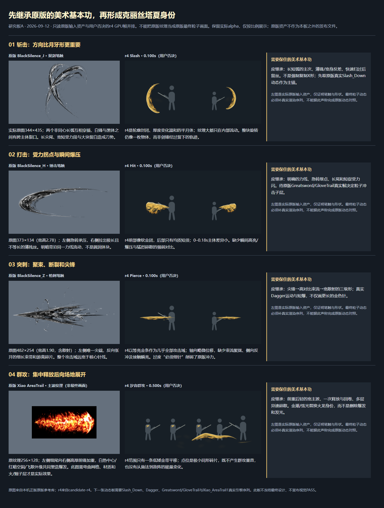
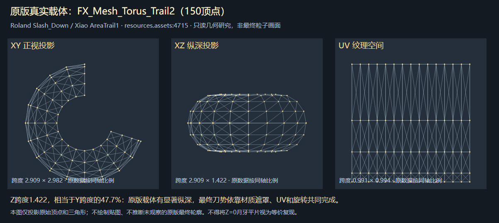
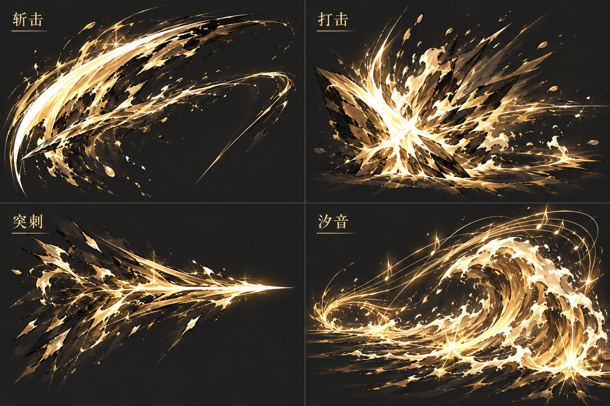

# 克丽丝塔夏：以原版真实美术为锚的重制

> **最新Hit语义纠正（2026-09-13）**：用户明确：“打击你不应该理解为‘用拳头击打某个地方’，而应该是‘一招比斩击横向更有力的刀剑纵砸’。”Hit01–04的拳式爆点方向全部否决。恢复Greatsword主刀拖迹，建立“主势纵落→触地→退散”；压波和碎光只作次级。第7.4节为当前最小实施合同，覆盖此前删除主C、加入Glove星核的Hit方案。
>
> **Slash状态**：白金版Slash11已经原reviewer配色及角色上下文PASS，用户随后明确“这个斩击我很满意”。Slash11的材质、笔触、动线与0.35定位固定；本次只重定Hit，不重开已接受Slash。原黑体不是必须保留的主题颜色。

2026-09-12。**重新开启设计；r4（`f76433e0`）已被用户否决，其视觉PASS不再有效。** 已完成原图、实际Mesh、原始PS曲线与失败帧对照，以下冻结可开始实施的约束。后续以隔离的后台Unity Editor重放逐步校准，不以启动游戏或取得真Player帧为前提；尚未观察的最终外观不声称已验证。

用户当前正在电脑上工作：禁止桌面控制、窗口切换、桌面截图、浏览器操作及游戏/Steam启动。只允许文件分析和获授权的后台Unity。本文已有参考板是此前生成的本地研究文件；不再重新操作浏览器制作新图。Editor的离屏RenderTexture输出属于本地引擎产物，不是桌面截图。

用户纠正：不能整套完全复刻，不代表不能继承原版成熟的基本功、设计、动线。此前自行增加的“必须全部从零生成”“每效果恰好五PS”“主体只能一个Mesh”“必须低密度”“不允许glow”均撤销。系统数量、贴图来源形式和是否发光是实现选择，不是美术目标。

## 一、已经看见的差距

研究板A已经生成并打开检查：

可放大HTML：`../references/christasha-native-redesign/brush-vs-rejected-r4.html`。输入路径与SHA256见同目录`sources.json`（完整名`brush-vs-rejected-r4-sources.json`）。左侧是实际原版笔触/纹理，不是原版完整粒子截图；右侧是r4实际GPU帧。原图按比例展示，透明部分只合成到中性灰底。

已实际打开：原版黑沉默双剑`Sprite:23432`、锤`23760`、枪`23658`、拳套2 `22465`，邵AreaTrail `Texture2D:3115`；以及r4的Slash、Hit、Pierce、Mass阶段表和Slash 0.100s原尺寸帧。

| 被拒动作 | 实际可见的问题 | 不能再采用的修复方式 |
| --- | --- | --- |
| Slash | 主体从起到落是一枚边界封闭、厚薄反差不足的弯金片；材质纹理被限制在内部，外轮廓极完整；形体整体转向，仍读成香蕉/月牙物件 | 在同一175°平片上继续叠Perlin纹或多撒十几个点 |
| Hit | 前部是软金团，边缘几根均质短须；0–0.18s主体形体/亮度变化弱，缺骤然承压与碎散重音 | 把前部再加宽、再统一染亮；这只会做成更大的蜡团 |
| Pierce | 单一等亮金条占据全部可见攻击域；侧向散射几乎不形成第二尺度，只有轻微平移和变长 | 继续强调“必须唯一细针”以致删掉原版的聚束与反冲 |
| 汐音 | 小脚环、细线、低矮金带匀速经过战场，命中为小同形碎片；各阶段没有能量等级差 | 将金带变宽或增加更多相同点位；缺少的是集中爆发和展开，不是数量 |

对应实现根因：`ChristashaParticleBuilder.Shape`让所有动作共用一条双边带状网格生成逻辑；`StrokeBrush`的统一金色起伏几乎成为全库材质身份。`ChristashaParticleVisual`强制五个固定角色系统，而主体只发射一个；这样做虽便于技术验证，却使不同动作被同一种平滑材质和轮廓语言压扁。新方案可以保留已有API、单时钟和清理合同，必须解除这一美术结构限制。

## 二、具体原版锚点与已经核实的形状事实

### 斩击：玩家罗兰 Durandal 下斩

动态锚点：`FX_PC_RolRang_Slash_Down`，完整资源路径为`prefabs/battle/diceattackeffects/new/fx/pc/rolrang/fx_pc_rolrang_slash_down`。权威调用在`SteriaBuild/Assembly-CSharp/BehaviourAction_BlackSilence_SpecialDurandal.cs`的`SetDurandal`，下斩使用S12，随后上斩与收刀是另外的动作，不是一个月牙原地摆动。

笔触辅助锚点：`BlackSilence_J`双剑原图344×435。它有两条不同曲率、不同长度的斜弧，宽的受力区迅速收成极细长尖尾；主体内黑白对冲，裂口跨过主体宽度，负形也参与力度。可继承的是长短、粗细、明暗、空实和穿插关系，不能将“不要全抄双剑”误解为只允许一条均匀月牙。

本次定向读取了真正原版Mesh，而非根据PS计数猜测。Slash_Down的主载体是`resources.assets:4715 / FX_Mesh_Torus_Trail2`，150顶点，范围X[-1.491,1.418]、Y[-1.491,1.491]、Z[-0.711,0.711]。它具有明显纵深，不是Z=0的固定月牙。最终刀势由此载体、材质遮罩、UV及旋转共同产生。`FX_Mat_PC_RolRang_MainTrail`区分MainTex/Noise/ColorNoise，原版轮廓不能只从网格边界推出。

上图按原始顶点/索引绘制：正投影是有缺口的环带，侧向具有厚度，UV展开仍为条带。几何数据在`native-selected-mesh-reference-only.json`，只供本地研究，不作为发布输入。它证明原版的载体结构，不能单独证明最终shader渲染轮廓。

建议继承：原版载体/材质造成的透视弧势与短促扫动、锋口和半透明尾迹的异步消散。拟议差异应在温暖金白锋口、深琥珀潮影、局部金屑和次级潮线；不是把原版刀势改成规整装饰月牙。不再使用r4的175°平片、统一82°扫动或单主粒子作为约束。

### 可直接重放的Slash曲线约束

序列化层级必须一起恢复：根下`FX_PC_RolRang_Slash_ani`初始scale=0.3、quaternion=(1,0,0,0)；其下Main_Trail1 quaternion=(0.1186824,0.9929323,0,0)，Main_Trail2又在Main_Trail1下另有旋相。不得把这些父变换归一化成XY平面后只留一个Z角。

Main_Trail1与Main_Trail2不是同轮廓同速度的复制壳。原始RotationModule使用不同角速与衰减曲线：

| 原始模块 | Main_Trail1 | Main_Trail2 |
| --- | --- | --- |
| 寿命 | 0.7s | 0.6s |
| 初始角速scalar | 61.0865 rad/s | 26.1799 rad/s |
| 中间关键点（归一化年龄→乘数） | 0.230938→0.049587 | 0.411438→0.165283 |
| 首点/末点 | 0→1，1→0 | 0→1，1→0 |
| 仅积分该模块在0.050s的累积角 | 约145.3° | 约68.2° |
| 仅积分该模块在0.100s的累积角 | 约224.8° | 约121.8° |

计算保存于`../references/christasha-native-redesign/native-slash-rotation-envelopes.json`，包含原始Hermite关键点和斜率。上述累积角仅表示simulationSpeed=1的PS模块积分，**不是包含父系、Animator后的屏幕刀头角度**。它足以证明原版用极快主锋与较慢轮廓形成相位差，不能改成两条同步缓转弧。首个参考Editor版本应原样保留这些曲线；新主题版先保留同样速度/寿命，只改美术职责色与有意义的次级潮丝，看到重放后再定局部调整。

### 打击：Greatsword刀剑纵砸，主刀先于落点

原先把锤/拳套笔触与Greatsword的压力子层组合成横向爆点，误解了用户的“打击”。该方案及Hit01–04均不再成立；原图仍保留为研究历史，不作为当前Hit形状要求。

当前唯一主锚是`FX_PC_RolRang_Greatsword`完整原数据重放和其主刀层级。保留`Main_Trail1/Main_Trail2/SwingTrail`及原Clip的关系，先让上方刀势向剑尖落点纵落，随后才触地压开和退散。`GloveTrail_cross`不是新Hit的必需依赖，不能放大拳星核替代纵砸。具体恢复/删除、时序与实现点见7.4。

### 突刺：玩家罗兰 Dagger 的短促聚束

动态锚点：`FX_PC_RolRang_Dagger`，由`BehaviourAction_BlackSilence_ShortSword`及SpecialDurandal短剑段指定。

笔触锚点：`BlackSilence_Z`原图482×254，整体宽高约1.90，包含散射。虽然左侧只有一个尖端，后侧却由多条细长束带、不等宽黑白断裂和宽域飞屑组成。**窄核心不等于整个攻击域必须细窄。** r4把“唯一尖锋”错误地实现成几乎没有侧向变化的一条均质金针。

实际几何证据：Dagger的Slash1 renderer使用`FX_Mesh_Plane / resources.assets:4755`，只是四顶点平面；其尖锋主要由Flash材质、Size与Velocity形成，而非一块预先画死的尖针Mesh。Plane_0 `4749`是另一张偏移平面，用于其余子层。仅从“这是Mesh粒子”推导要做一块金针几何是错误路径。

建议继承：前锋突然伸出、中心束流快速变窄变亮、尾部在更宽的锥形域中短促反冲；轴向光线、少量碎片、模糊空气尾迹同时服务冲刺方向。金白中心只占核心，暗金/海灰间隙应真正打断主体，而非成为内部条纹。不得靠拖慢飞行让用户看到静态金针。

### 汐音：邵范围释放的能量层级 + 乐团弦线身份

动态主锚点：`FX_Mon_Xiao_AreaTrail1`，在`XiaoEgo_S1`组合中有实际依赖；额外检查`FarAreaAtk_Xiao_610005`与`FarAreaEffect_Xiao_AreaAtk_610005`。其脚本明确分开蓄势S3、激活范围粒子/释放结算/S4、结束；不是一份低位图形从开始到结束匀速漂移。

已经查看的AreaTrail原纹理256×128：一端是极细碎尾，另一端迅速变成高厚前锋；白热中心、深色孔洞和游离外缘形成三个层级。其主载体同样使用有纵深的`FX_Mesh_Torus_Trail2`，还有不同速度/寿命的波、火、烟、碎屑；原纹理不是最终平贴画面。

身份辅助锚点：`fx_illusioncard_4_n_orchestra_start`的弦线与独立亮点。只从它继承线条彼此错开、起势和消散的节奏，音乐身份由克丽丝塔夏「汐音：光耀万海」卡图的金潮、琴弦/谱线与晨光构成。不要为了避开邵的火龙身份，连原版范围爆发的强度与大形展开也删掉。

建议动作：起势在施法者附近收束，释放阶段产生一次大形和亮度明显跃升，前锋迅速向敌阵展开并回卷，成功目标产生独立有重音的短爆，主波退成更薄的潮丝与弦线。高潮允许短暂经过角色躯干，不再硬性限制“永远低于脚踝/脸”；持续遮挡与满屏泛白仍需控制。既有游戏结算时刻默认不动，美术应围绕它重排蓄/放强弱。

## 三、实现选择不先限制美术

优先比较两条路线的真实首样，而不是先认定所有基础资源都必须自造：

1. **运行时借用游戏原生视觉资产，再形成新的组合。** 从用户游戏的Resources加载原版可用纹理、Mesh、材质或视觉prefab，clone后改造。本模组依赖用户已安装游戏，不再次分发原图。原生材质/网格比例与动画可帮助保持基本功。需要按职责重组、局部主题变化和新动作设计，不能只把整个原prefab统一Tint成金色。
2. **忠实提取原版造型与时序后原创实现。** 原版Mesh形状/透视、透明层次、笔触长短和阶段曲线成为实际约束，原创差异落在主题纹理、色阶、局部形变与层间组合。先做同机位灰度形/明暗对照，再调金白，不用程序化金纹证明原创性。

运行时复用不得带来游戏脚本、伤害、镜头或音频副作用。原prefab可能在Awake/OnEnable启动脚本，不应未经清查直接活体Instantiate后再移除。由实现owner先检查实际依赖并提供干净视觉装配方案；复用视觉组件时保留必需材质/Animator数据，去掉会影响战斗的逻辑。该技术可行性由主线程确定，不在本研究稿中虚构已经跑通。

原生材质必须按Shader语义处理。已读`FX_Mat_PC_RolRang_MainTrail`的`_MainColor=(2,2,2,0)`与`_OutColor=(1,1,1,0)`；`FX_Mat_Trail2_OutLine`的`_MainColor=(0,0,0,0)`是黑暗轮廓层。这里alpha为0不能按标准RGBA误判成透明，HDR白锋与黑描边也不能被统一Tint改成同等亮金。Dagger的`FX_Mat_Flash1`另用`_MaskPower/_Mask_Fuzziness`，Smoke用`_Alp`，Xiao主波用`_Color/_DissolveColor`。保留原色阶与mask曲线后，逐白锋、暗边、烟、火、飞屑职责改色；不可先归一化全部颜色再加一个金色乘数。

模块取舍须服从当前动作语义。Slash_Down、Dagger的既有研究保留；Greatsword的18个`Cylinder001_v_*`碎地Mesh及原地裂符号仍可排除，但**不能连同Main_Trail1/Main_Trail2主刀一并删除**。此前只留下压力/喷散的Hit抽取已被用户否决，恢复主刀并将触地层降为次级，见7.4。

沿用的合同只有游戏边界：当前Play/Advance/Duration/StopAndClear/Tint接口、单视觉时钟、正确父系/朝向/坐标、目标Point仅来自成功列表、正常取消清理、当前47处视觉字段范围。角色数量、材质数、粒子层数及主形数量根据画面决定，不能再统一钉死为五PS。

## 四、立即可执行的来源与取舍

| 动作 | 本轮初始Native来源 | 先保留 | 主题版实质改变 | 不搬入 |
| --- | --- | --- | --- | --- |
| Slash | Slash_Down | 原torus、MainTrail材质机制、两Trail独立角速/旋相、Particle1尾散 | 白锋与深暗轮廓保留亮暗职责；增加由锋尾分离的暖金潮丝，部分尾粒改为金白/暗金不同层；局部次级弧的宽长/时间区别需可见 | r4固定香蕉Mesh、五角色硬要求 |
| Hit | Greatsword刀剑纵砸 | Main_Trail1/Main_Trail2/SwingTrail的主刀、原父系/Clip，随后Ground_Wave1/少量喷散/烟 | 继承Slash11白金笔触层次，形成更重的纵向扫落、末端压实与短回落；不是Slash整体旋90° | Glove拳星核、Hit01–04爆点主形、Cylinder/Upper_stone及装饰地裂 |
| Pierce | Dagger | Flash平面与shader、SlashSmoke、轴向/侧向粒子、短爆衰减；Distortion先在参考保留 | 金白中心束、暗金空隙与更宽的游离光丝；发射方向保持，细节形与侧丝节奏区别于原短剑 | r4实心金针几何；没有证据就删除全部辅烟/反冲 |
| Mass | Xiao_AreaTrail1 + Orchestra_start | 有深度的主波与mask/dissolve、异速副波/碎屑；独立音乐线条 | 从琴弦收束释放到金潮展开；保留白亮峰值、暗孔与回卷，将火焰色阶/火舌身份改为金潮及弦光；成功点位采用独立短爆 | 原龙、地景/战斗逻辑、全套一键染金；r4低位匀速金带 |

这些是可开始装配和重放的选择；真实画面出现技术不兼容或造型问题时，用明确帧证据修改，不再为了等待所有参考完美重放而停止第一种效果。

主题变化必须真的改变角色身份：Xiao原纹理自带橙红火色，简单乘金色Tint仍会保留红火。应在缓存初始化时对选定的视觉纹理/颜色输入做亮度分段的金白—蜜金—暗琥珀映射，保留原alpha、形状断裂、mask和dissolve；或使用同等可追踪的shader色阶改造。该派生仅在运行时从游戏原始资产形成，不把游戏原图另打包。先保留原生明暗结构，再改变色阶与局部组合；不能把暗孔一起拉亮。Slash/Hit/Pierce也按白锋、暗边、烟、飞屑逐职责改造，避免整个原prefab一键染金。

## 五、后台Editor比较协议

先完成Slash_Down三PS的隔离Editor转换与重放，然后依次加入Dagger、Greatsword的完整参考、Xiao_AreaTrail1和Orchestra_start。每个输出正常速度短片与起/峰/散代表帧，记录root scale/rotation、simulationSpeed、Animator曲线是否完整与相机。全过程不触碰用户桌面、不启动游戏。

参考版与新主题版必须使用**相同的资源转换、shader和渲染路径**。能使用原Shader对象时优先使用；若编译后Shader在Editor不能直接重用，需要近似实现，则两边使用同一近似Shader，并标出保留的原Mesh/纹理/PS/Animator数据及缺失部分。不能左边用未经证实的“原版样子”，右边用另一个渲染器再下审美结论。

研究板B标为“原始数据Editor重放 / r4失败版 / 主题改造候选”，不能标成“原版实战”或“原Player原样”。只有Shader/Animator确实原始且重放路径被核实的部分才声称原样。原始Sprite板仍仅是笔触参考，不替代这一动态比较。

最终视觉接受条件：正常速度下能感到起势与爆发的明确差值，主锋方向与残迹互相解释；灰度下仍有清楚层次；金白主题保留原版成熟的粗细、留白、冲击与消散。r4的香蕉片、蜡金团、单金针、低矮匀速条只要仍是第一眼观感，就应REVISE。编译、PS数量、资产hash或API检查通过均不能推翻这一视觉判断。

## 六、Imagegen概念板的可执行补充

已实际打开主线程生成的`../references/christasha-native-redesign/concept-gold-tide-v1.png`，同目录prompt与JSON记录来源。它是本轮主题/构图参考，不是动画成品，也不是原版实际画面。

概念板比r4明确改善了四件事：白锋与暗金存在强烈等级差；断裂负形穿过主体而非仅在表面起伏；打击具有集中的爆压核心；汐音有真正回卷的高厚浪锋和顺着浪势延伸的细弦。这些可以与原版torus/材质/相位机制结合，并不要求照搬整幅静画。

**实现必须保留四项：**

1. **主刀迹与副刀迹的等级。** 斩击保留一条明显更亮、更宽的主刃，副迹较细、较长并错开方向/时刻；不能让所有弧等粗等亮。概念图的大外弧和较弱横向副迹提供层级；落地时由原版MainTrail双层独立曲线承担，副潮线后生或后退。无需把静图全部交叉线一次铺满。
2. **穿透主体的留白与三种碎散尺度。** 保留锋口连续性，同时让暗孔/透明裂口真正切进中段与尾部。粗短残片、中等金丝和极细光屑应有不同速度、寿命和亮度；不能重新合成一块内部有花纹的封闭金色物体。概念图中的锐黑楔块只用作明暗/负形参考，不把每种攻击都做成飞岩爆炸。
3. **主动作之后的重音与落差。** 概念板的爆压只可用于Hit纵砸后的触地次级反馈，不能据此把Hit设计成拳式星爆。Hit主画面必须先有自上而下刀剑落势；突刺仍保留尖端、聚束、反冲的三级结构。整张概念图的“打击”格不再作为Hit主形模板。
4. **有厚度的回卷浪锋与顺势弦线。** 汐音必须从收束进入明显更强的高厚前锋，浪内留有大开口，边缘碎成金白泡丝；弦线沿主浪切线/上缘延伸并错时退去。概念图的谱线与音符是音乐身份提示，动画中可抽取少量弦线和亮节点，不需要塞满全部音符、星芒与装饰。

落地顺序：先在同一原始数据Editor重放中确认主锋/暗轮廓与相位关系；再按上面四项加入主题版变化；最后增加概念板的细节密度。概念板的高光数量、静态复杂度、左右方向都不是硬性参数。其突刺朝右，而生产资产默认-X；方向由既有挂点合同处理，不能从概念图直接推断游戏朝向。

另已实际查看`output/christasha-native-redesign/hanzhou-reference-01/`下寒昼小兵斩击、打击、突刺的`dark_0006.png`。这三张是**寒昼AB在同类Editor渲染器的局部帧**：白亮窄锋与深蓝体积的分工、刀口附近有限泛光、烟与主形的软硬反差都比r4更清楚，可用于最低层级/材质辨识对照；当前只凭这三帧不评价其完整时序，也不将它们改称罗兰参考或替换本轮原版主锚。

## 七、原始Shader重放后的首轮实施冻结

**本节覆盖前文暂定取舍，允许立即实施；它冻结的是首轮候选合同，不宣称新主题已经视觉通过。** 主线程已将原始Shader/Mesh/PS/Clip依赖转换至隔离Editor，metadata中所列Shader均supported=True，无游戏自定义MonoBehaviour执行。已亲看以下实际输出：

- `output/christasha-native-redesign/editor-native-slash-03/FX_PC_RolRang_Slash_Down/mid_0001/0006/0015/0030.png`：0.017s近环→0.1s开放C→0.25s多道碎锋→0.5s细碎余迹。这个过程中近环和C只是瞬间投影，不是可取出当固定轮廓的“原版月牙”。
- `output/christasha-native-redesign/editor-native-all-01/`下Dagger、Greatsword、GloveTrail_cross的mid_0006/0015，及Xiao_AreaTrail1、Orchestra_Start、ShadowSlsah的mid_0006/0015/0030。Dagger为尖光线与松散烟/细屑；Greatsword明显带回转C和地面破坏；Glove有锐利瞬亮星与很大的空间烟/拖迹；Orchestra是多层大谱环/圆点，不是几条天然适合群攻的细弦。
- 上述source使用分别固定的相机，不能用屏幕像素直接比较源效果大小。Xiao相机ortho=35导致主要火波仅约40px，Orchestra的场景用途则占满画面；这些是源用途/取景差异，不是新书页应照搬的尺寸。新候选需在同一角色/挂点基准下设置世界尺寸。

### 7.1 每个动作的模块合同

| 输出 | 保留的原生机制 | 删除/不引入的原生模块 | 新主题的实质变化 |
| --- | --- | --- | --- |
| Slash | `Slash_Down`整套Main_Trail1/Main_Trail2/Particle1，保留torus、父层倾转、原Clip与两套旋相/侵蚀 | 不克隆第二份完整原生C来充当装饰层；不返回r4Body | 白锋仍是亮度最高层，暗轮廓仍暗；沿锋尾加入一条非闭合、较长较细、与主峰错时的金潮断笔；小部分尾粒变为金叶，另留暗粒支撑负形。副迹来自独立局部mask/定向粒子，不从完整概念刀光PNG裁出 |
| Hit | **恢复**Greatsword `Main_Trail1/Main_Trail2/SwingTrail`主刀及原Clip/父变换；Ground_Wave1、Particle1、少量Upper_Particle/Smoke在触地后辅助 | **移除Glove拳星核依赖**；不使用HitPressureFan替代主刀；排除Cylinder、Upper_stone、Ground_Crack/原Ground_Light视觉，但保留其必要祖先Transform | 有分量的白金刀势从上落向Hit.png剑尖地面位置，触地才向低位两侧压开；主刀在全程视觉权重高于落点。恢复Greatsword独立旋相/收势，不旋转Slash11充当新动作。详见7.4 |
| Pierce / Projectile | `Dagger/Slash1`原Flash材质、SlashSmoke/Smoke、Particle1/2、Rush_Particle；保留原生细尖锋与短爆曲线 | 不用r4实心金针；Distortion可在背景诊断确认后留，不能成为不透明影块；Burn保留为低对比压气层而非大白底 | 核心白金线仍细锐；其后增加较宽但疏断的2–3股金色束流与反向/侧向碎片，使攻击域有尖锋、束流、散射三个尺度。Projectile沿原有运行时轨迹消费同主题，不额外制造目标确认命中 |
| Area | `Xiao/Trail`原torus+主波mask/dissolve，Trail2/3/4/Wave中的异速副波、Spark1/2；参考版先完整，主题版按职责调整 | 不复制原龙或场景脚本；不用r4匀速低金条；Trail_Fire不以原红火外观直接发布；Burn不做全场大黑雾 | 主纹理在运行时或共享shader输入做亮度分段金潮重映射，保留白亮泡尖与暗孔；以一份有明显纵向卷起的前锋快速展开，副波落在前锋后/下而非四条平行等重C；追加原创泡丝/浪尖粒子，高潮时覆盖敌阵躯干高度的一部分 |
| Cast | `Orchestra/Line1、Line2`的细线采样与size/rotation/color曲线可作起势骨架 | 不引入Line3/4全套谱环、particle_2大圆点、Burn与满屏Distortion | 源层收成施法者周边短暂小弦环，颜色统一到白金/蜜金而不是彩虹；再以独立开放弦带向浪锋延伸。若原谱纹难以抽成干净弦线，则换原创弦带mask，仍沿已接受节奏，不硬拉伸满圈音符 |
| Point | 复用Hit的短核心、扇散和细丝职责，裁成点位独立模块；允许借用同一个Glove核心材质 | 不再用r4小金条/小C；不生成Greatsword地形模块 | 一次白金接触重音后放出短泡丝/小金片，0.2–0.4s收尾；只给manager成功列表的世界点生成，与Area根分离 |

### 7.2 色阶、节奏和补充素材

不要对所有Renderer写同一个金色Tint。先保留Clip原采样结果，再在材质职责上做主题映射；原有HDR亮度、alpha的Shader语义、mask和侵蚀曲线不能被常量覆盖。白锋保持接近暖白；中等能量用蜜金；深描边保留近黑或很暗的海灰/琥珀。暗孔应暗于中间金层一个明显等级。局部HDR/glow允许使用，峰值必须短，不能通过持久大泛光掩盖形体。

普通Slash的该轮起始设计已由用户满意的Slash11取代，保持其当前实现。Hit不再采用0.06–0.09s抢先爆星的方案；以Greatsword原0.15s节点为第一候选的触地次级反馈，必须先展示主刀纵落，详见7.4。Pierce保留原Dagger的锐线寿命关系，新增中宽束流短于后方烟，避免视觉重新变成一块宽针。

汐音保留当前manager的释放/结束合同：Cast积蓄时Area尚未满幅；释放附近在约0.12–0.2s内完成显著展开，随后回卷消散。绝不以1秒匀速平移代替高潮。谱线在浪前缘之外以较细长的路径连接施法者与主浪，跟随浪势错时退场，不能全程固定一个地面装饰环。

允许增加少量原创局部素材来达到概念板的丰富度：`潮丝断笔`（长细、不闭合、有穿透裂口）、`尖泡/金叶`（至少两种不对称轮廓）、`开放弦带`。它们是粒子局部输入而不是完整斩/击/刺/群攻母图；不把概念四宫格切成四张静态攻击贴图。无需为了原创重新制作原版已经成熟的torus或Flash平面。

### 7.3 最小工程交接与首轮验收

- 保持既有七输出名、Play/Advance/Duration/StopAndClear/Tint外部接口，以及47处视觉字段与游戏挂点/结算合同。内部改为按原生来源/模块职责组合；不再要求五个固定PS角色。
- 原资源依赖转换和实际游戏Resources来源分别记录，生产不重新分发游戏原图。保留原节点相对路径供Clip采样，删模块时不破坏保留层的父变换。材质需要按实例/主题隔离，避免原Clip或主题映射改到全局共享原资源。
- 第一张候选先做Slash，提供原始数据重放与主题版同相机、同seed、同采样方法的正常速度及0.017/0.05/0.1/0.25/0.5s对照；接受其基础锋势与金潮差异后按本表补Hit/Pierce/Mass。不要先批量把七个原prefab全染金。
- 主题版要比原始孤立源更接近concept的主次/留白/爆压，但不按静图强行堆满每一帧。看到另一条均质金C、另一团蜡金或一整片静态金针即返修。源Shader支持、bundle成功及曲线采样一致，只证明技术来源成立，不替代视觉接受。

### 7.4 Hit纵砸：当前最小实施合同（2026-09-13）

**一句话目标：一招比横向Slash更有分量的白金刀剑纵砸，先从上方带出主刀，再落到Hit.png剑尖指向的地面，最后退散。** 触地压波/碎光是结果，不是主动作。Hit01–04拳式爆点全部拒绝，不能以放大星核或把Slash11旋转90°修补。

本次实际复看完整Greatsword重放`editor-native-all-01/FX_PC_RolRang_Greatsword/mid_0001、0006、0012、0015、0024.png`，对应约17/100/200/250/400ms；另看Hit03的50/100/250ms。完整源先有主刀弧，0.15s后才出现触地喷散；Hit03则先几根横针，再中心金星，后退成散点，正好缺失了用户要的主刀。两种源的相机不同，不能直接比较屏幕像素大小。

#### 恢复哪些真实数据

| 原模块 | 已核实原数据 | 新Hit处理 |
| --- | --- | --- |
| Main_Trail1（PS68370） | t=0、寿命0.7s，角速scalar43.633rad/s；原Greatsword Clip7033长1s | 恢复为主刀宽迹；保留原torus、Clip、局部旋相和侵蚀，按Slash11的白金材质方法映色 |
| Main_Trail2（PS67417） | t=0、寿命0.5s，角速8.727rad/s，独立父内旋相 | 恢复较慢的切锋/压实段；逐条采原始MPB，不按材质默认黑值强行压黑 |
| SwingTrail（PS68882） | 延迟0.15s、寿命0.3s；角速43.633、曲线首值-1，到年龄0.201约-0.078 | 保留触地附近反向收势的短刀拖迹；恢复原Mesh与曲线，撤销Hit03的0.18旋速削弱和扇形Mesh替换 |
| Ground_Wave1 / Upper_Particle | 原延迟0.15s；压波/喷散在主刀之后 | 留作剑尖落点的一次次级压开，低位向两侧散；先保留0.15s节点，不再前移成0.065s拳爆 |
| Particle1 / Smoke | 粒子约0.1s，烟约0.25s开始 | 少量沿主刀尾部/触地结果退散，不能遮住主刀或形成拳式大烟团 |

原层级中`Greatsword_ani`有0.3尺度和X180°，Main_Trail1在其下，Main_Trail2/SwingTrail又在Main_Trail1下；Ground_Wave1在Ground_Light1下。恢复这些祖先和原Clip绑定。删除地裂/石头的Renderer/PS可以保留必要空Transform，不能因不画地裂而删除整条祖先链。

不再加载或渲染Glove的Trail1_cross作为Hit核心；移除其来源硬依赖。继续排除18个Cylinder碎地Mesh、Upper_stone、Ground_Crack和原Ground_Light画面。Upper_Particle_Start若保留，仅作刀势起动的少量方向提示，不能继续沿水平轴从爆点发射。

#### 主势 → 触地 → 退散

| 阶段 | 第一候选时序 | 应看到什么 |
| --- | --- | --- |
| 主势 | 0–0.15s | 17–50ms已可见上方白金刀迹，随后锋头向前下方扫落。主迹跨过手部/剑身所解释的路径，具有宽而有断口的受力段与较细上尾；触地组不抢先爆发 |
| 触地 | 约0.15–0.25s | 主刀下段到达剑尖落点，短收势压实；只有此时才出现低位压波与少量碎光。主刀面积/线性势能仍明显大于落点反馈，不出现独立拳星 |
| 退散 | 约0.25–0.60s | 上部旧尾先薄，下部重迹后收，碎光短回弹/横散；不在触地后再长出一次完整上挑或继续维持白金宽板 |

更重不等于统一放大、整体放慢或增亮：Greatsword主1原角速约为Slash_Down的0.71倍，主2约0.33倍，本来就有更持重的双迹关系。先使用这两套原曲线；相对Slash11只在下落受力段略增笔触宽度/末段停势，上尾继续细而快退。首轮可从受力段可见宽度约Slash的1.15–1.3倍试起，保持透空断口；这是待看图的局部宽度关系，不是统一root scale或最终验收数值。纵向包络覆盖上方起刀至剑尖地面，横向不扩大成罩住两人的场景拱门。

Hit必须用其确切角色图校准：512画布、PPU50、原Hit XML pivot、原持握及脚点不变；正在去除的是烘焙地爆，不改变剑指地姿态。Slash的0.35不能自动授予Hit尺度PASS。以可见剑刃延长线和地面交点固定接触组，以手部—上方刀势—剑尖的连续关系固定主刀组；不得挪整个人物或改成拳姿配合特效。

#### 对实现点的最小修改

1. `CloneHitSourceSubset`的Greatsword保留集合加入Main_Trail1、Main_Trail2及Particle1，保留SwingTrail、Ground_Wave1、必要喷散/烟；取消Glove克隆。参考侧必须可显示完整Greatsword，不再把删掉主刀的旧subset当“原版Hit”。
2. `BuildHit`撤销主动作使用HitPressureFan、早发星核及旧统一burst短化。恢复原主刀Mesh/旋速/时序，在本Hit自己的艺术空间校准纵落；只复用Slash11已成立的白金采样映色/局部brush方法，不改BuildSlash及其动作参数。
3. `HitPlayback.AfterAnimator`不再把每个系统强拉到同一爆点并改成水平前扇。主刀组保留Animator更新后的原始矩阵和父系，必要调整只放在外部Hit艺术空间；只有触地组定位到剑尖地面。Main1/Main2/Swing的色通道独立restore→sample→map，沿用单时钟。
4. `EmitHit`及原HitFoil/Threads/Dust只在触地附近辅助，改为低位两侧/短上弹；取消从0.07s开始三轮水平拳式扩散。先关闭这些辅助也必须看得出完整“刀剑纵砸”，再少量恢复，不新增复杂系统弥补主形缺失。

最小验收：同方法原Greatsword/新Hit白金主题对照，取17/50/100/150/200/250/400/600ms，并在实际Hit姿态左右各看起刀、落点和退散。第一眼必须先看见一记纵落刀剑，触地反馈晚于主势、落在剑尖地面；与满意的Slash11区别来自Greatsword自己的旋相、受力段和落地收势，而非把Slash旋90°。新Hit尚无PASS；不改已接受Slash11，也不跑游戏来完成这份设计。
